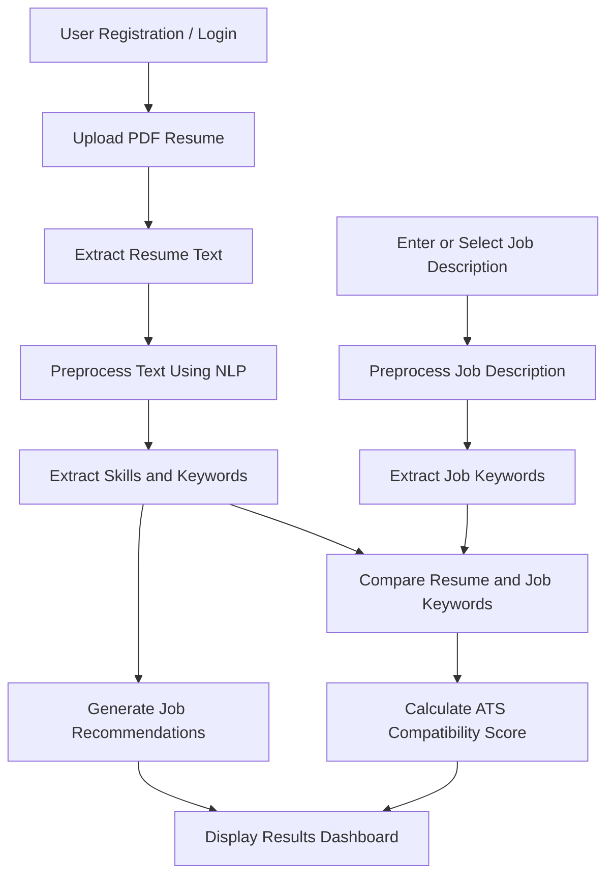

# HireSense — AI-Based Resume Screening & Applicant Tracking System

<p align="center">
  <strong>Smarter Resume Screening. Better Job Matches.</strong>
</p>

<p align="center">
  An AI-powered Applicant Tracking System (ATS) that analyzes resumes, calculates job-specific compatibility scores, and recommends relevant career opportunities using Natural Language Processing (NLP) and Machine Learning techniques.
</p>

<p align="center">
  
  
  
  
</p>

---

## 📌 Overview

**HireSense** is an AI-based resume screening and Applicant Tracking System designed to simplify the recruitment process by automating resume analysis and job matching.

Traditional recruitment often involves manually reviewing hundreds of resumes, making the process time-consuming and potentially inconsistent. HireSense addresses this challenge by extracting relevant information from resumes, comparing candidate profiles with job descriptions, generating ATS compatibility scores, and recommending suitable job roles.

Built using **Python, Django, and NLP techniques**, HireSense provides a web-based platform where users can upload resumes, evaluate their suitability for specific job opportunities, and explore career recommendations based on their skills and qualifications.

## 🎯 Key Features

- **🔐 User Authentication:** Registration, login, logout, and session management.
- **📄 Resume Upload:** Upload resumes in PDF format for automated analysis.
- **🧠 Resume Parsing:** Extract text from PDF resumes using `pdfplumber`.
- **🔍 NLP-Based Preprocessing:** Clean and normalize resume text through lowercase conversion, tokenization, stopword removal, and punctuation removal.
- **📊 ATS Compatibility Scoring:** Compare resume keywords against job descriptions and generate a compatibility score.
- **💼 Job Recommendations:** Suggest relevant job roles based on skills and keywords identified in the candidate's resume.
- **📈 Results Dashboard:** Display resume analysis results and ATS scores.
- **🕘 History Tracking:** Access previously generated screening results.
- **🌐 Web-Based Interface:** Interact with the system through a Django-powered application with an HTML, CSS, and JavaScript frontend.

## ⚙️ How It Works



### Workflow Explanation

1. **Authentication:** The user logs into the application.
2. **Resume Upload:** The user uploads a resume in PDF format.
3. **Text Extraction:** The system extracts textual content using `pdfplumber`.
4. **Text Preprocessing:** The extracted content is converted to lowercase, tokenized, and cleaned of stopwords, punctuation, and unnecessary characters.
5. **Feature Extraction:** Relevant skills, educational qualifications, experience-related information, and domain-specific keywords are identified.
6. **Job Matching:** The processed resume is compared with the selected job description.
7. **ATS Scoring:** The system calculates a compatibility percentage based on matching keywords.
8. **Recommendations:** The application suggests job roles aligned with the candidate's profile.
9. **Results and History:** The user can view the analysis results and access previous screening records.

## 🧮 ATS Scoring Methodology

HireSense calculates an ATS compatibility score by comparing the keywords identified in a resume with those present in a job description.

The scoring formula is:

\[
\text{ATS Score} =
\frac{\text{Matching Keywords}}
{\text{Total Keywords in Job Description}}
\times 100
\]

**Example:**

Suppose a job description contains 20 relevant keywords, and a resume matches 15 of them.

\[
\text{ATS Score} = \frac{15}{20}\times100=75\%
\]

The resulting score is **75%**, indicating the proportion of job-description keywords matched by the resume.

> **Note:** The ATS score is a keyword-based compatibility indicator, not a definitive measure of a candidate's ability, qualifications, or likelihood of being hired.

## 🛠️ Technology Stack

| Technology | Purpose |
|---|---|
| Python | Core programming language and backend logic |
| Django | Web application framework, routing, and authentication |
| HTML5 | Structure of the web interface |
| CSS3 | Styling and responsive interface design |
| JavaScript | Client-side interactivity |
| pdfplumber | Text extraction from PDF resumes |
| NLP techniques | Text preprocessing, tokenization, and keyword extraction |
| SQLite / MySQL | Relational database for application data |
| Pandas / NumPy | Data processing, where required by the implementation |
| Scikit-learn | Machine learning and text similarity utilities, where used |

*The final two libraries are optional stack entries; retain them only if they are used in your actual codebase.*

## 📂 Core Modules

### 1. User Authentication Module
Handles user registration, login, logout, and session management using Django's authentication functionality.

### 2. Resume Upload Module
Accepts PDF resumes and validates uploaded files before processing.

### 3. Resume Parsing Module
Extracts text from uploaded resumes and prepares it for subsequent analysis using text preprocessing techniques.

### 4. ATS Scoring Module
Compares resume keywords with job-description keywords to calculate a compatibility score.

### 5. Job Recommendation Module
Identifies relevant job categories by mapping extracted skills and keywords to available job roles.

### 6. Dashboard and History Module
Presents ATS results, job recommendations, and previously generated analysis records through the web interface.

## 🖥️ Application Pages

The application includes the following interfaces:

- **Login Page:** Secure user authentication.
- **Dashboard:** Central access to the application's functionality.
- **About Page:** Information about the HireSense project.
- **Resume Upload Page:** Upload a PDF resume for analysis.
- **ATS Score Results Page:** View the generated compatibility score.
- **Job Recommendation Page:** Explore relevant job roles.
- **History Page:** Review previous analysis results.

*Add screenshots of your actual application in this section to make the repository more informative.*

Example screenshot structure:

```text
screenshots/
├── login.png
├── dashboard.png
├── resume_upload.png
├── ats_results.png
├── job_recommendations.png
└── history.png
```

Once these screenshots exist in your repository, you can display them using Markdown:

```markdown

```

## 🚀 Getting Started

Follow these steps to run HireSense locally.

### Prerequisites

Make sure you have the following installed:

- Python 3.10 or a version compatible with your project's dependencies
- pip
- Git

### 1. Clone the Repository

```bash
git clone https://github.com/YOUR-USERNAME/HireSense.git
cd HireSense
```

Replace `YOUR-USERNAME` and `HireSense` with your actual GitHub username and repository name.

### 2. Create a Virtual Environment

**Windows:**

```bash
python -m venv venv
venv\Scripts\activate
```

**macOS / Linux:**

```bash
python3 -m venv venv
source venv/bin/activate
```

### 3. Install Dependencies

If your repository contains a `requirements.txt` file:

```bash
pip install -r requirements.txt
```

If you do not have one, install Django and the PDF-processing library first:

```bash
pip install django pdfplumber
```

Install any additional libraries required by your project's imports and configuration.

### 4. Configure the Database

If the project uses Django's default SQLite database, apply the migrations:

```bash
python manage.py migrate
```

If your project uses MySQL, configure the database connection in the Django settings and install the appropriate database driver before running migrations.

### 5. Create a Superuser (Optional)

To access the Django administration interface, create a superuser:

```bash
python manage.py createsuperuser
```

Follow the prompts to configure the administrator account.

### 6. Start the Development Server

```bash
python manage.py runserver
```

Open the following URL in your browser:

**http://127.0.0.1:8000/**

> These instructions assume that `manage.py` is in the repository root. If your project uses a different directory structure, adjust the commands accordingly.

## 📊 Example Output

The following table illustrates the type of results HireSense is designed to produce. These are illustrative examples, not independently verified benchmark results.

| Resume Skills | Target Job | Example ATS Score | Example Recommendations |
|---|---|---:|---|
| Python, Machine Learning, Django | Data Scientist | 78% | Data Scientist, ML Engineer |
| Java, Spring Boot, REST APIs | Backend Developer | 85% | Backend Developer, Java Developer |
| HTML, CSS, React | Frontend Developer | 80% | Frontend Developer, UI Developer |
| NLP, Deep Learning, Python | AI Engineer | 72% | AI Engineer, NLP Researcher |

Actual scores and recommendations depend on the uploaded resume, the job description, and the implemented matching logic.

## ⚠️ Current Limitations

HireSense is a project-level implementation with several areas for improvement:

- Keyword-based scoring may not fully capture the meaning or context of a candidate's experience.
- Synonyms and semantically similar skills may not be recognized as equivalent.
- Complex PDF layouts, tables, multiple columns, and graphics may affect text extraction.
- Scoring depends on the quality and relevance of the supplied job description.
- External, real-time job listings are not part of the current documented scope.
- ATS scores should not be used as the sole basis for recruitment decisions.

## 🔮 Future Enhancements

Potential improvements include:

- **TF-IDF and Cosine Similarity:** Improve text representation and resume-to-job-description matching.
- **Transformer-Based NLP:** Explore BERT or similar models for semantic similarity.
- **Live Job Integration:** Connect to authorized job data sources for updated job listings.
- **AI Resume Feedback:** Provide personalized suggestions for improving resume content.
- **Multi-Format Support:** Extend parsing to DOCX and other document formats.
- **Multilingual Processing:** Support resumes written in different languages.
- **Explainable Scoring:** Show matched and missing skills to make ATS results easier to interpret.
- **Recruiter Analytics:** Introduce candidate comparison and recruitment insights.

## 🔒 Privacy and Responsible Use

Resumes contain personal information. Any real-world deployment should implement appropriate access controls, secure file handling, data retention policies, and protection of stored candidate information.

HireSense is intended to assist with resume analysis and job matching. Its scores and recommendations should support, rather than replace, human judgment. Recruitment decisions should be reviewed for fairness and potential bias.

## 🎓 Academic Project

**Project Title:** HireSense: AI-Based Resume Screening and Applicant Tracking System

**Institution:** University of Petroleum and Energy Studies (UPES), Dehradun

**Programme:** Bachelor of Technology — Computer Science and Engineering

**Project Guide:** Mrs. Bhavana Kaushik

### Project Team

- Hima Swarupa Padala
- Atharv Chandorikar
- Amulya Dang
- Janvi Agrawal

## 🤝 Contributing

Contributions, suggestions, and improvements are welcome.

1. Fork the repository.
2. Create a new branch for your changes.
3. Implement and test your changes.
4. Submit a pull request describing your improvements.

<p align="center">
  <strong>HireSense — Making Resume Screening Smarter, Faster, and More Accessible.</strong>
</p>
